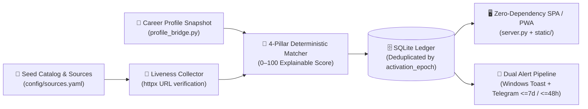

# CertRadar 🎯

> 🌐 **English** · [Leia em Português (PT-BR)](README.pt-BR.md)

[](pyproject.toml)
[-10b981.svg?style=for-the-badge)](tests/)
[](docs/superpowers/specs/2026-11-11-cert-radar-design.md)
[](DEPLOY.md)

**Deterministic certification curation, 4-pillar explainable career-gap matching, and official exam voucher radar.**

---

## ⚡ TL;DR — Why This Exists

Finding high-ROI certifications and limited-time 50%–100% exam vouchers without drowning in marketing noise requires **explainable prioritization, not LLM guesswork**:

- **Explainable 0–100 Scoring:** Ranks opportunities deterministically against target career tracks (AI Product Management, Context Engineering, Data & AI) and real CV skill gaps.
- **Zero-Noise Anti-Spam:** Verifies official URLs before surfacing items (`collector.py`) and deduplicates Windows Toast + Telegram alerts per `activation_epoch` (`<= 7d` and `<= 48h` deadlines).
- **Zero-Cost Full Stack:** Built with Python (`Pydantic v2`, `httpx`), SQLite, a dependency-free local/PWA SPA, and **158 automated tests passing (100%)** — ready for local runs or 24/7 free-tier deployment via [`Dockerfile`](Dockerfile) and [`render.yaml`](render.yaml).

---

## 📊 4-Pillar Explainable Scoring Engine

Implemented in [`src/cert_radar/matcher.py`](src/cert_radar/matcher.py):

| Pillar | Weight | What It Evaluates |
| :--- | :---: | :--- |
| **1. Role Alignment** | **35 pts** | Matches certification domain against target career tracks and primary archetypes. |
| **2. Skill Gap Closure** | **25 pts** | Prioritizes credentials closing concrete skill gaps detected from CV/job analyses. |
| **3. Recruiter Signal** | **20 pts** | Weights industry-recognized vendors and hands-on lab credentials. |
| **4. Cost & Voucher Urgency** | **20 pts** | Boosts free tracks and active 50%–100% discount vouchers expiring within `<= 14 days`, while suppressing certifications already earned on the CV. |

- **Two Curated Tracks:** `official_voucher` (proctored exams with active discounts/challenges) vs. `free_continuous` (verifiable zero-cost micro-credentials).
- **Lifecycle Tracking:** Persistent SQLite workflow (`radar` → `saved` → `studying` → `completed` / `ignored`).

---

## 🏗️ Pipeline Architecture



---

## 📂 Project Structure

```text
src/cert_radar/
├── cli.py             # CLI commands (serve, check-radar, sync-profile, setup-telegram, add-url)
├── collector.py       # Catalog loader & HTTP link liveness verification
├── db.py              # SQLite persistence & deduplicated alert ledger
├── matcher.py         # 4-pillar deterministic scoring & redundancy suppression
├── models.py          # Pydantic v2 domain models (Certification, CandidateProfile, MatchResult)
├── notifier.py        # Windows Toast & Telegram notification dispatcher
├── profile_bridge.py  # Read-only bridge for CV / career profile alignment (PII-free snapshot)
├── server.py          # Lightweight HTTP API, healthcheck/auth & SPA static server
└── static/            # Zero-dependency frontend (index.html, app.js, style.css)
```

---

## 🚀 Quick Start & Deployment

```bash
# 1. Install dependencies (Python >= 3.11, uv or pip)
pip install -e .

# 2. Launch the local SPA dashboard
python -m cert_radar serve

# 3. Run radar collection, profile matching, and alert checks
python -m cert_radar check-radar

# 4. Run full unit & integration test suite (158 tests)
pytest -v
```

- **Cloud / Mobile PWA Deployment:** See [`DEPLOY.md`](DEPLOY.md) for zero-cost 24/7 hosting on Render (`render.yaml` + `Dockerfile`) with optional Basic Auth and Cloudflare Quick Tunnel support.
