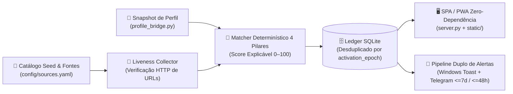

# CertRadar 🎯

> 🌐 [Read in English](README.md) · **Português (PT-BR)**

[](pyproject.toml)
[-10b981.svg?style=for-the-badge)](tests/)
[](docs/superpowers/specs/2026-11-11-cert-radar-design.md)
[](DEPLOY.md)

**Curadoria determinística de certificações, matching explicável por lacunas de carreira em 4 pilares e radar oficial de vouchers.**

---

## ⚡ Resumo Executivo — Por que Este Projeto Existe

Encontrar certificações de alto ROI e vouchers oficiais de 50%–100% antes do vencimento exige **priorização determinística e explicável, sem alucinações ou ruído**:

- **Score Explicável (0–100 pts):** Ranqueia certificações contra trilhas-alvo (AI Product Management, Context Engineering, Data & AI) e lacunas reais de habilidades do currículo.
- **Anti-Spam por Ciclo:** Verifica links oficiais ativos antes de exibir (`collector.py`) e desduplica alertas no Windows Toast + Telegram por `activation_epoch` (`<= 7 dias` e `<= 48h`).
- **Stack Completa a Custo Zero:** Python (`Pydantic v2`, `httpx`), SQLite, SPA/PWA sem dependências externas e **158 testes automatizados aprovados (100%)** — pronto para execução local ou nuvem gratuita via [`Dockerfile`](Dockerfile) e [`render.yaml`](render.yaml).

---

## 📊 Motor de Pontuação Explicável (4 Pilares)

Implementado em [`src/cert_radar/matcher.py`](src/cert_radar/matcher.py):

| Pilar | Peso | Critério Avaliado |
| :--- | :---: | :--- |
| **1. Alinhamento ao Cargo** | **35 pts** | Aderência aos cargos-alvo e arquétipos principais de carreira. |
| **2. Fechamento de Skill Gaps** | **25 pts** | Prioriza certificações que cobrem lacunas concretas mapeadas no currículo/vagas. |
| **3. Sinal para Recrutadores** | **20 pts** | Pondera credenciais reconhecidas pelo mercado e laboratórios práticos. |
| **4. Custo & Urgência de Voucher** | **20 pts** | Impulsiona trilhas gratuitas e vouchers ativos expirando em `<= 14 dias`, suprimindo certificações já conquistadas. |

- **Duas Trilhas Curadas:** `official_voucher` (exames oficiais com descontos/desafios ativos) vs. `free_continuous` (microcredenciais gratuitas verificáveis).
- **Ciclo de Vida:** Persistência SQLite (`radar` → `saved` → `studying` → `completed` / `ignored`).

---

## 🏗️ Arquitetura do Pipeline



---

## 📂 Estrutura do Projeto

```text
src/cert_radar/
├── cli.py             # Comandos CLI (serve, check-radar, sync-profile, setup-telegram, add-url)
├── collector.py       # Carregador de catálogo e verificação HTTP de links ativos
├── db.py              # Persistência SQLite e ledger desduplicado de alertas
├── matcher.py         # Scoring determinístico em 4 pilares e supressão de redundância
├── models.py          # Modelos Pydantic v2 (Certification, CandidateProfile, MatchResult)
├── notifier.py        # Despacho para Windows Toast e Telegram Bot
├── profile_bridge.py  # Ponte read-only com perfil de carreira (snapshot sem PII)
├── server.py          # API HTTP leve, healthcheck/auth e servidor estático da SPA
└── static/            # Frontend nativo sem dependências (index.html, app.js, style.css)
```

---

## 🚀 Início Rápido e Deploy

```bash
# 1. Instalar dependências (Python >= 3.11, uv ou pip)
pip install -e .

# 2. Abrir o dashboard SPA local
python -m cert_radar serve

# 3. Rodar coleta, matching de perfil e checagem de alertas
python -m cert_radar check-radar

# 4. Executar toda a suíte de testes (158 testes)
pytest -v
```

- **Deploy Cloud / PWA Mobile:** Consulte [`DEPLOY.md`](DEPLOY.md) para hospedagem gratuita 24/7 no Render (`render.yaml` + `Dockerfile`) com autenticação opcional e suporte a Cloudflare Quick Tunnel.
